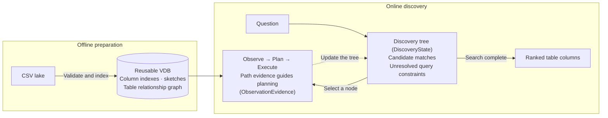

# Table Discovery Agent

## Overview

The Table Discovery Agent finds relevant tables in a local CSV lake from a
natural-language question. This AgentScope example implements the core ideas
of TIDE for multi-step table discovery.
Composable operators find, score, and combine candidate columns, while a
constraint-guided discovery tree uses table relationships to guide the search.
A reusable on-disk index lets later queries skip rebuilding the lake indexes.

The demo lake supports two-hop discovery from `store_sales` through
`store_directory` to `region_demographics`.

## Quick Start

Run these commands from the `table_discovery_agent` directory. You need Python
3.11, a local copy of the weights and tokenizer for
`BAAI/bge-large-en-v1.5`, and a
DashScope API key for the default Qwen model.

```bash
python3.11 -m venv .venv
source .venv/bin/activate
python -m pip install -r requirements.txt
cp config.example.toml config.toml
```

In `config.toml`, set `model.embedding.model_dir` to your local model directory
and uncomment `vdb_dir = "./vdb"` under `[data]`. The example already points
`data.lake_dir` to the four synthetic CSVs in `data/demo_lake`.

```bash
python main.py --config config.toml --validate
python main.py --config config.toml --build-index
```

Enter your DashScope API key when prompted, then ask the agent to find
population data by joining sales records through the store directory.

```bash
read -rsp "DashScope API key: " DASHSCOPE_API_KEY
printf '\n'
export DASHSCOPE_API_KEY

query="Join sales to the store directory on store_id, then to demographics on region_id. \
Require both joins before filtering final population to 30,000–40,000."

python main.py --config config.toml --ask "$query"
```

Both providers follow `store_id` to the store directory and `region_id`
to regional demographics, then apply the population range. The expected
match is

```text
region_demographics.population
```

To try the same discovery task with DeepSeek Flash, enter a DeepSeek API key
and switch providers. This reuses the index built above.

```bash
read -rsp "DeepSeek API key: " DEEPSEEK_API_KEY
printf '\n'
export DEEPSEEK_API_KEY

python main.py --config config.toml --chat-provider deepseek --ask "$query"
```

## Use Your Own CSVs

Put comma-delimited UTF-8 `.csv` files directly in a directory and set
`data.lake_dir` to that directory. Use a separate `data.vdb_dir` for its
indexes. Each CSV needs a header with unique, nonempty column names. The
reader accepts a UTF-8 byte order mark and treats missing fields as missing
values.

```bash
python main.py --config config.toml --validate
python main.py --config config.toml --build-index
python main.py --config config.toml --output ./results/answer.txt \
    --ask "Find tables with population data"
```

Validation reads every CSV and exits with an error if any file fails.
Results identify columns as `table.column`, where `table` is the filename
without `.csv`. For example, `region_demographics.population` points to the
`population` column in `region_demographics.csv`. Choose a new output file
for each saved query.

To list schemas, run the CLI with only the lake path. For direct column
retrieval, use `--search`, which queries an index without invoking a chat model.

```bash
python main.py --lake /path/to/csvs
python main.py --config config.toml --search "population" --top-k 3
```

## Configuration Reference

CLI options override TOML values, which override built-in defaults. Relative
TOML paths resolve from the config file's directory. Relative CLI paths resolve
from the working directory. Both accept `~`.

| TOML key | CLI option | Requirement or default |
| --- | --- | --- |
| `data.lake_dir` | `--lake` | Required CSV directory |
| `data.vdb_dir` | `--vdb-dir` | Required for `--build-index`. Queries build indexes in memory when unset |
| `output.path` | `--output` | Query results go to the terminal by default. Set a new path to save UTF-8 text |
| `model.embedding.encoder` | `--encoder` | `bge`, the bundled encoder |
| `model.embedding.model_dir` | `--embedding-model` | Local model directory required for indexing and search |
| `model.chat.provider` | `--chat-provider` | `qwen` by default. Also accepts `deepseek` |
| `model.chat.name` | `--chat-model` | `qwen-plus` for Qwen or `deepseek-flash` for DeepSeek |
| `search.max_rounds` | `--max-rounds` | `6` rounds per agent query |
| `search.stagnation_limit` | `--stagnation-limit` | `3` rounds without progress |
| `search.candidate_limit` | `--candidate-limit` | `10` candidate tables per round |

- **CLI modes.** Use one of `--validate`, `--build-index`, `--ask`, or
  `--search` per invocation. For `--search`, `--channel` selects `metadata`
  (default) or `content`, and `--top-k` defaults to `5`. Direct search
  returns the matched column, its inferred type, and its similarity score.
- **Chat credentials.** `--ask` reads `DASHSCOPE_API_KEY` for Qwen and
  `DEEPSEEK_API_KEY` for DeepSeek. A CLI provider switch selects that
  provider's default model unless you also pass `--chat-model`. If an older
  config sets `name = "deepseek-flash"`, set `provider = "deepseek"` to keep
  using it or remove the model name to use the Qwen default.
- **Index reuse.** Build a VDB before querying with `data.vdb_dir` set.
  It stores both HNSW indexes, the table and column catalog, SQLite sketches,
  and the relationship graph. The source CSVs stay in the lake. Rebuild after
  changing the CSVs or embedding model. Each build publishes a new generation.
  Direct search loads one HNSW index into memory and the agent loads both.
  With a persisted VDB, candidate CSVs and sketches are read on demand.

## Architecture and Project Structure



The agent uses AgentScope's `AgentBase`, `Msg`, chat models and formatters,
`Toolkit`, and `StateModule` for orchestration and state. Indexing and tool
execution run locally. The selected chat provider receives the query and
discovery context, which can include table names and schemas, relationship
evidence, and prior tool actions.

```text
table_discovery_agent/
├── README.md
├── agent.py                 # Discovery orchestration and planner toolkit
├── main.py                  # CLI and configuration
├── config.example.toml
├── requirements.txt
├── data_lake.py             # CSV discovery, schema reading, and loading
├── indexing/               # Column formatting, embeddings, sketches, and VDB
├── discovery/              # Constraints, prompts, relationships, and tree state
├── tools/                  # Seekers, rankers, combiners, and termination
└── data/demo_lake/         # Four synthetic CSVs
```

## Developer Reference

<details>
<summary>Toolkit entry points and encoder interface</summary>

### Toolkit entry points

- `agent.create_planner_toolkit()` powers `--ask`. The planner passes discovery node IDs, and the toolkit resolves them to candidate tables.
- `tools.create_toolkit()` registers standalone operators for direct Python calls. Callers pass column queries, candidate columns, or reference tables explicitly.

The `--search` CLI queries the column index directly.

### Text encoder interface

The CLI selects an implementation with `create_encoder(name, model_path)` in `indexing/embedding.py`. The same encoder handles metadata, content, and queries during a search run. Additional implementations must provide `encode(texts)` that accepts a sequence of strings and returns a contiguous two-dimensional NumPy array of L2-normalized `float32` vectors. Return one row per input string, in input order, with a consistent embedding dimension across calls.

</details>

<details>
<summary>Format columns</summary>

The formatting example uses pandas and the dependencies installed above.

`data_lake.read_table(table)` loads a discovered CSV table into a pandas DataFrame. In `indexing/column_formatter.py`, the `format_columns(tables: Mapping[str, pd.DataFrame]) -> tuple[ColumnRepresentation, ...]` API accepts DataFrames keyed by table ID and returns one record per column. Each record has `table_id`, `column_name`, `column_type`, `metadata`, and `content` fields.

`metadata` describes the column using its schema information. `content` describes the observed values. The TIDE-style formatting uses TF-IDF to select representative values for text columns and summary statistics for numeric columns. This step produces text for later indexing.

```bash
python - <<'PYTHON'
from pathlib import Path

from data_lake import load_data_lake, read_table
from indexing.column_formatter import format_columns

tables = load_data_lake(Path("data/demo_lake"))
frames = {table.id: read_table(table) for table in tables}
columns = {
    (column.table_id, column.column_name): column
    for column in format_columns(frames)
}

for table_id, column_name in (
    ("store_sales", "store_id"),
    ("region_demographics", "population"),
):
    column = columns[table_id, column_name]
    print(f"{table_id}.{column_name}")
    print(f"  Metadata: {column.metadata}")
    print(f"  Content:  {column.content}")
PYTHON
```

</details>

<details>
<summary>Estimate column frequencies and ranges</summary>

`build_column_statistics` builds frequency and range summaries keyed by
`(table_id, column_name)`. It uses a Count-Min sketch over non-null categorical
values and a quantile histogram over finite numeric values. These estimates can
serve as features when ranking candidate columns. The example uses the
dependencies installed above.

```bash
python - <<'PYTHON'
from pathlib import Path

from data_lake import load_data_lake, read_table
from indexing import build_column_statistics

tables = load_data_lake(Path("data/demo_lake"))
frames = {table.id: read_table(table) for table in tables}
stats = build_column_statistics(frames)

sales_ids = stats["store_sales", "store_id"]
population = stats["region_demographics", "population"]
print(sales_ids.frequency("S01"))  # Approximately 2/3
print(population.range_fraction(30000, 40000))  # Approximately 0.5
PYTHON
```

</details>

<details>
<summary>Estimate key overlap and grouped correlation</summary>

Build key sketches separately from column statistics.
`KeySketch(table, key_column, k=256)` builds a bottom-`k` sketch of a pandas
DataFrame's distinct keys, excluding null keys. As in TIDE, keys match by
their string representation. `overlap(other)` estimates Jaccard similarity
from the bottom-`k` sample of the union and is exact when the union fits in
the sample. The examples use the dependencies installed above.

```python
from pathlib import Path

from data_lake import load_data_lake, read_table
from indexing import KeySketch

tables = load_data_lake(Path("data/demo_lake"))
frames = {table.id: read_table(table) for table in tables}

sales = KeySketch(frames["store_sales"], "store_id")
directory = KeySketch(frames["store_directory"], "store_id")
print(sales.overlap(directory))  # 1.0
```

`correlation(other, left_column, right_column)` computes Pearson correlation
between the per-key numeric means for shared sampled keys. Duplicate rows for
a key contribute to its mean. The method returns `None` when the correlation
is undefined.

```python
import pandas as pd

from indexing import KeySketch

left = pd.DataFrame({"key": ["a", "a", "b", "c"], "x": [2, 6, 8, 12]})
right = pd.DataFrame({"key": ["a", "b", "b", "c"], "y": [2, 3, 5, 6]})

left_sketch = KeySketch(left, "key")
right_sketch = KeySketch(right, "key")
correlation = left_sketch.correlation(right_sketch, "x", "y")
print(f"{correlation:.1f}")  # 1.0
```

</details>
